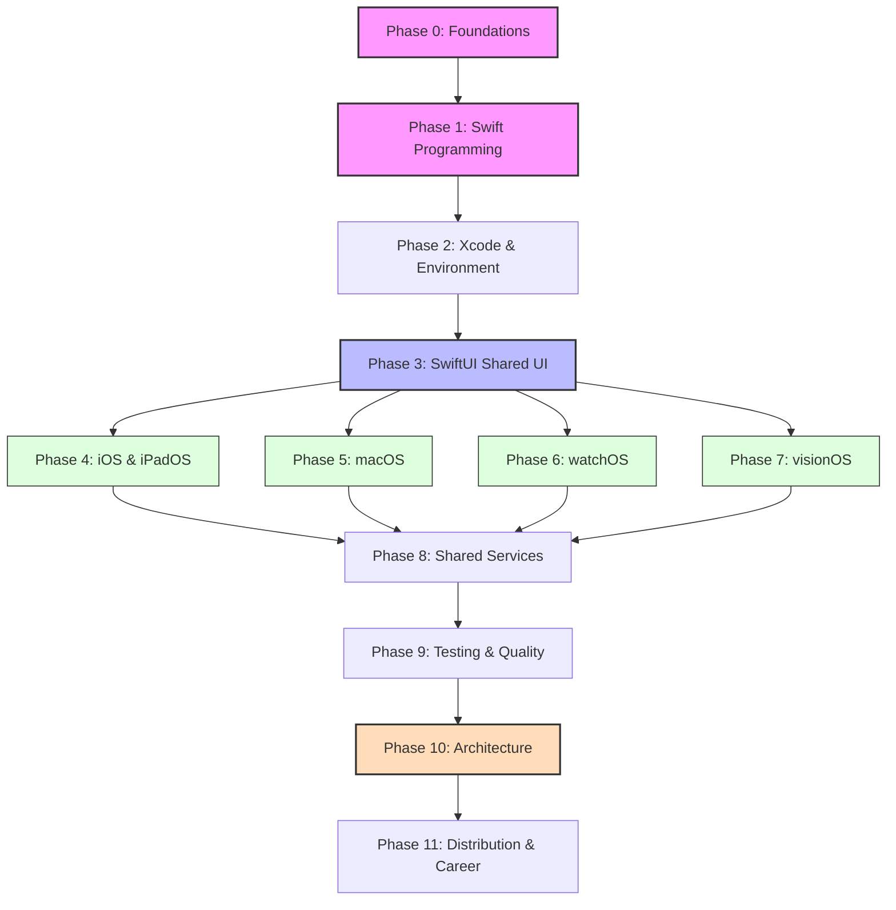

# Dependency Map & Learning Roadmap

This document outlines the logical flow of the Apple Ecosystem Engineering Masterclass. The curriculum is designed as a directed graph where certain foundational blocks must be completed before platform-specific specialization can begin.

## 1. The Dependency Graph

## 2. Critical Path Analysis

The **Critical Path** is the minimum sequence of modules required to build a professional, multi-platform application.

**Path:** `P0` $\rightarrow$ `P1` $\rightarrow$ `P2` $\rightarrow$ `P3` $\rightarrow$ `P4` (iOS) $\rightarrow$ `P8` $\rightarrow$ `P9` $\rightarrow$ `P10` $\rightarrow$ `P11`.

### Hard Dependencies:
*   **Swift (P1) $\rightarrow$ Everything:** You cannot use any Apple framework without a deep understanding of Swift's type system and concurrency.
*   **SwiftUI (P3) $\rightarrow$ Platforms (P4-P7):** All modern Apple platforms use SwiftUI as the primary UI layer. Attempting to learn visionOS or watchOS without SwiftUI is counter-productive.
*   **Shared Services (P8) $\rightarrow$ Architecture (P10):** You cannot design a professional architecture (MVVM, TCA, etc.) if you don't understand how the underlying services (Networking, Persistence, CloudKit) operate.

## 3. Knowledge Categorization

To optimize learning, we split topics into **Core/Shared** and **Platform-Specific**.

### Core / Shared Knowledge (Learn Once, Apply Everywhere)
*   **Language:** Swift Syntax, Optionals, ARC, Generics, Actors.
*   **Tooling:** Xcode, Git, SPM, Instruments.
*   **UI Logic:** State management, View composition, Animations.
*   **Infrastructure:** REST APIs, SwiftData, Keychain, Unit Testing.

### Platform-Specific Knowledge (Specialization)
*   **iOS/iPadOS:** App Lifecycle, UIKit Interop, Multitasking, Push Notifications.
*   **macOS:** AppKit, Menu Bar, Sandboxing, File System access.
*   **watchOS:** Complications, HealthKit, Connectivity, Glancable Design.
*   **visionOS:** RealityKit, Volumetric Windows, Gaze/Pinch interaction, Spatial Audio.

## 4. Major Milestones

| Milestone | Phase | Deliverable | Outcome |
| :--- | :--- | :--- | :--- |
| **The Coder** | P1 | CLI Tool | Ability to solve algorithmic problems in Swift. |
| **The UI Builder** | P3 | Interactive Prototype | Ability to create a polished, adaptive SwiftUI interface. |
| **The App Developer** | P4 | Production iOS App | Ability to ship a fully functional app to the App Store. |
| **The Specialist** | P5-P7 | Multi-platform Suite | Mastery of desktop, wearable, and spatial interfaces. |
| **The Architect** | P10 | Modular Framework | Ability to design a scalable, testable enterprise codebase. |
| **The Professional** | P11 | Portfolio & Release | Readiness for senior-level employment or independent shipping. |
