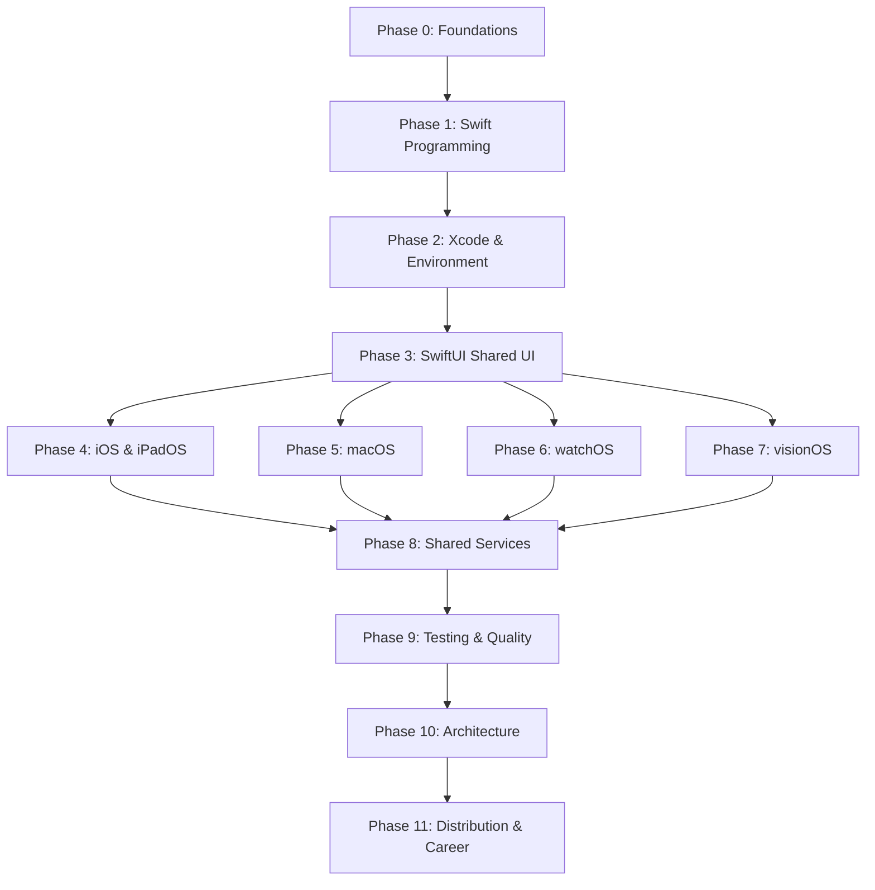

# Apple Ecosystem Engineering Masterclass (2026) - Complete Curriculum

## Table of Contents
1. [Executive Overview](#executive-overview)
2. [Prerequisite Assessment](#prerequisite-assessment)
3. [Dependency Map & Learning Roadmap](#dependency-map--learning-roadmap)
4. [Master Syllabus](#master-syllabus)
    * [Phase 0: Programming Foundations](#phase-0-programming-and-development-foundations)
    * [Phase 1: Swift Programming](#phase-1-swift-programming--beginner-to-advanced)
    * [Phase 2: Xcode & Environment](#phase-2-xcode-and-the-apple-development-environment)
    * [Phase 3: SwiftUI Foundation](#phase-3-swiftui--the-shared-ui-foundation)
    * [Phase 4: iOS & iPadOS Development](#phase-4-ios-and-ipados-development)
    * [Phase 5: macOS Development](#phase-5-macos-development)
    * [Phase 6: watchOS Development](#phase-6-watchos-development)
    * [Phase 7: visionOS & Spatial Computing](#phase-7-visionos-and-spatial-computing)
    * [Phase 8: Shared Services](#phase-8-shared-services-and-advanced-apple-technologies)
    * [Phase 9: Software Testing & Quality](#phase-9-software-testing-and-engineering-quality)
    * [Phase 10: Architecture & Production](#phase-10-architecture-and-production-engineering)
    * [Phase 11: Distribution & Career](#phase-11-app-distribution-monetization-and-career-readiness)
5. [Detailed Weekly Study Plan](#detailed-weekly-study-plan)
6. [Platform Competency Matrix](#platform-competency-matrix)
7. [Hands-on Exercise Catalogue](#hands-on-exercise-catalogue)
8. [Project Portfolio Specifications](#project-portfolio-specifications)
9. [Testing & Assessment Framework](#testing--assessment-framework)
10. [Curated Resource Directory](#curated-resource-directory)
11. [Progress Tracker](#progress-tracker)
12. [Capstone Project Specification](#capstone-project-specification)
13. [Final Readiness Checklist](#final-readiness-checklist)

---

## 1. Executive Overview

### Program Vision
The Apple Ecosystem Engineering Masterclass is a professional-grade curriculum designed to transform a learner from a complete beginner (or a general-purpose developer) into a Senior-level Apple Platform Engineer. 

Unlike traditional tutorials that focus on "how to build a specific app," this program focuses on **First Principles of Engineering**. It teaches the "why" behind the "how," emphasizing memory safety, concurrency, architectural scalability, and the unique human-interface guidelines (HIG) of each Apple platform.

### Intended Outcomes
Upon completion of this program, the learner will be able to:
*   **Architect Multi-Platform Systems:** Design and implement a shared business logic layer using Swift Packages that powers native experiences across iOS, macOS, watchOS, and visionOS.
*   **Master Modern Swift:** Write data-race safe, high-performance code using Swift 6 concurrency (async/await, actors, and strict concurrency checking).
*   **Build Adaptive User Interfaces:** Create fluid, accessible, and responsive UIs using SwiftUI that adapt seamlessly from a 40mm Watch face to a spatial immersive environment in visionOS.
*   **Implement Professional Persistence:** Manage complex data models using SwiftData and CloudKit for seamless synchronization across the user's Apple devices.
*   **Engineer for Quality:** Implement a rigorous testing strategy using the Swift Testing framework, incorporating unit, integration, and UI tests.
*   **Navigate the App Lifecycle:** Handle the full product lifecycle from initial prototyping in Xcode to App Store Connect submission and production monitoring.

### The Learning Philosophy: "Fundamentals First, Platforms Second"
The curriculum is structured to avoid redundant learning. Instead of teaching "iOS Networking," "macOS Networking," etc., we teach **Networking in Swift** once, then teach how that networking layer is consumed by different platform-specific UI patterns.

**The Progression Path:**
1.  **The Engine (Swift):** Mastering the language, type system, and concurrency.
2.  **The Toolkit (Xcode & SwiftUI):** Mastering the environment and the shared UI language.
3.  **The Platforms (Deep Dives):** Specializing in the unique constraints and capabilities of iOS, iPadOS, macOS, watchOS, and visionOS.
4.  **The Infrastructure (Advanced Tech):** Persistence, CloudKit, Security, and Networking.
5.  **The Professionalism (Engineering):** Testing, Architecture, and Production DevOps.

### Target Audience Tracks
*   **Track A (The Absolute Beginner):** No prior programming experience. Includes a "Phase 0" on computer science fundamentals.
*   **Track B (The Polyglot):** Experienced in other languages (Python, JS, Java, etc.) but new to the Apple ecosystem. Skips basic CS fundamentals but focuses on Swift's unique value semantics and memory model.
*   **Track C (The Apple Developer):** Already familiar with Swift/iOS. Focuses on upgrading to Swift 6, mastering visionOS, and moving from "app builder" to "software architect."

---

## 2. Prerequisite Assessment

This diagnostic tool places learners into the correct learning track.

### The Diagnostic Quiz
**Section 1: General Programming Logic**
1. Do you understand the difference between a variable and a constant?
2. Can you explain what a loop (for/while) does and when to use it?
3. Are you comfortable with conditional logic (if/else, switch)?
4. Do you know how to organize code into functions/methods to avoid repetition?
5. Do you understand the concept of a "data type" (e.g., String vs. Integer)?

**Section 2: Object-Oriented & Functional Concepts**
1. Do you understand the concept of a "Class" and an "Object"?
2. Do you know the difference between an interface/protocol and a concrete class?
3. Are you familiar with the concept of "Inheritance" or "Composition"?
4. Have you used "Closures" or "Lambda functions" in another language?
5. Do you understand how to handle errors (e.g., try/catch blocks)?

**Section 3: Software Engineering Tooling**
1. Have you used Git (commit, push, pull, branch) before?
2. Are you comfortable using a Terminal/Command Line?
3. Do you know what a JSON object is and how it is used in APIs?
4. Have you ever used an Integrated Development Environment (IDE) like VS Code or IntelliJ?

**Section 4: Apple Ecosystem Experience**
1. Have you written any code in Swift before?
2. Have you ever used Xcode to build and run an app?
3. Do you understand the difference between SwiftUI and UIKit/AppKit?
4. Do you have an active Apple Developer Program membership?

### Track Mapping
*   **Track A (Absolute Beginner):** Answered "No" to more than 3 questions in Section 1. $\rightarrow$ **Start at Phase 0**.
*   **Track B (The Polyglot):** "Yes" to Sections 1, 2, and 3; "No" to Section 4. $\rightarrow$ **Start at Phase 1**.
*   **Track C (The Apple Developer):** "Yes" to most of Section 4. $\rightarrow$ **Start at Phase 3** (and supplement with Phase 1.6).

---

## 3. Dependency Map & Learning Roadmap

### The Dependency Graph

### Knowledge Categorization
*   **Core / Shared Knowledge:** Swift Syntax, Modern Concurrency, ARC, SwiftUI Basics, Observation, Xcode Workflow, SwiftData, Networking, Swift Testing.
*   **Platform-Specific Knowledge:**
    *   **iOS/iPadOS:** App Lifecycle, UIKit Interop, System Integration, Hardware APIs, Adaptive Layout.
    *   **macOS:** AppKit Interop, Windowing, File System, Desktop UX, Notarization.
    *   **watchOS:** Complications, Watch Connectivity, HealthKit, Crown Input, Power Mgmt.
    *   **visionOS:** Spatial UI, RealityKit, 3D Asset Pipeline, Gaze & Pinch, Spatial Audio.

---

## 4. Master Syllabus

### Phase 0: Programming and Development Foundations
**Objective:** Establish the mental model of a software engineer.

#### Module 0.1: Computational Thinking & Logic
*   **Difficulty:** Beginner | **Duration:** 1 Week
*   **Learning Outcomes:** Ability to decompose problems into algorithmic steps.
*   **Syllabus:** IPO model, Boolean logic, Sequence/Selection/Iteration, Pseudocode.
*   **Practical Assessment:** Create a logic-based solution for a "FizzBuzz" problem using only pseudocode.

#### Module 0.2: Programming Fundamentals
*   **Difficulty:** Beginner | **Duration:** 1 Week
*   **Learning Outcomes:** Understanding the building blocks of modern programming.
*   **Syllabus:** Variables/Constants, Basic Types, Control Flow, Functions, Collections.
*   **Practical Assessment:** A small project that takes user input and processes it through multiple conditional paths.

#### Module 0.3: The Professional Toolchain
*   **Difficulty:** Beginner | **Duration:** 1 Week
*   **Learning Outcomes:** Ability to manage code versions and use the command line.
*   **Syllabus:** Terminal Basics, Git Fundamentals, Branching & Merging, GitHub.
*   **Practical Assessment:** Resolve a forced merge conflict in a shared repository.

### Phase 1: Swift Programming — Beginner to Advanced
**Objective:** Mastery of the Swift 6 language, with a focus on safety and concurrency.

#### Module 1.1: Swift Basics & Type Safety
*   **Syllabus:** `let` vs `var`, Type Inference, Optionals (`if let`, `guard let`), Nil-Coalescing, Collections.
*   **Core Concept:** The Optional system as a safety mechanism against `nil`.
*   **Assessment:** Script that parses mixed-type data and safely extracts valid entries.

#### Module 1.3: Structs, Classes, and Enums
*   **Syllabus:** Structs (Value), Classes (Reference), Enums (Associated Values), Copy-on-Write, Properties.
*   **Core Concept:** Value vs Reference semantics.
*   **Assessment:** Technical review identifying where a Struct should be replaced by a Class.

#### Module 1.4: Protocol-Oriented Programming (POP)
*   **Syllabus:** Protocol Definitions, Extensions, Generics, Associated Types, Opaque Types (`some`) vs Existentials (`any`).
*   **Core Concept:** Composition over Inheritance.
*   **Assessment:** Refactor a deep class hierarchy into a flat, protocol-oriented design.

#### Module 1.5: Memory Management & ARC
*   **Syllabus:** ARC internals, Strong/Weak/Unowned references, Retain Cycles, Capture Lists in Closures.
*   **Core Concept:** Eliminating memory leaks in a reference-counted system.
*   **Assessment:** "Leak Hunt" exercise: find and fix 3 hidden leaks in a sample project.

#### Module 1.6: Modern Swift Concurrency
*   **Syllabus:** `async`/`await`, Structured Concurrency (`TaskGroup`, `async let`), Actors, `@MainActor`, `Sendable`, Cancellation.
*   **Core Concept:** Data-race safety in a multi-threaded environment.
*   **Assessment:** Implement a "Thread-Safe Cache" using an Actor.

### Phase 2: Xcode and the Apple Development Environment
**Objective:** Master the primary tool of the trade.

#### Module 2.1: Project Architecture & Configuration
*   **Syllabus:** Targets, Schemes, Build Settings, Build Phases, Asset Catalogs.
*   **Assessment:** Correctly configure a project to use Debug, Beta, and Release configurations.

#### Module 2.2: Debugging, Profiling & Instruments
*   **Syllabus:** LLDB, Breakpoints, Instruments (Time Profiler, Leaks, Allocations), `OSLog`.
*   **Assessment:** Profile a slow-loading list and identify the exact function causing the hitch.

#### Module 2.3: Signing, Capabilities & Distribution
*   **Syllabus:** Developer Accounts, Certificates, Provisioning Profiles, App Capabilities, App Store Connect.
*   **Assessment:** Successfully sign and deploy an app to a physical device with a specific capability.

### Phase 3: SwiftUI — The Shared UI Foundation
**Objective:** Mastery of declarative UI development.

#### Module 3.1: Declarative UI & View Composition
*   **Syllabus:** `View` protocol, Layout (HStack, VStack, ZStack, Grids), View Modifiers.
*   **Assessment:** Recreate a high-fidelity design mockup exactly using SwiftUI layout primitives.

#### Module 3.2: State Management & Data Flow
*   **Syllabus:** `@State`, `@Binding`, Observation Framework (`@Observable`), `@Environment`.
*   **Assessment:** Implement a complex form with real-time validation and state-driven button enabling.

#### Module 3.3: Navigation & Presentation
*   **Syllabus:** `NavigationStack`, `NavigationPath`, Sheets, Popovers, TabView, Deep Linking.
*   **Assessment:** Build a navigation flow that handles both Tab-based and Stack-based movements.

#### Module 3.4: Animations, Gestures & Visual Effects
*   **Syllabus:** Implicit vs Explicit Animations, Springs, Gestures (`Drag`, `Tap`, `Magnification`), Custom Shapes.
*   **Assessment:** Create a custom "Loading Spinner" using a combination of `RotationEffect` and a custom `Shape`.

#### Module 3.5: Accessibility, Localization & Adaptive Layouts
*   **Syllabus:** Dynamic Type, VoiceOver, Localization (`.stringfile`), RTL layouts, Size Classes.
*   **Assessment:** Pass a "Compliance Audit" for accessibility on a core app flow.

### Phase 4: iOS and iPadOS Development
**Objective:** Transform shared SwiftUI knowledge into a production mobile experience.

#### Module 4.1: The iOS App Lifecycle & Scene Management
*   **Syllabus:** `@main`, `ScenePhase`, Multi-window (iPadOS), Deep Linking.
*   **Assessment:** Implement a "Save Progress" feature that triggers during the `.background` phase.

#### Module 4.2: UIKit Interop & Advanced Interaction
*   **Syllabus:** `UIViewRepresentable`, `UIViewControllerRepresentable`, Coordinator Pattern, Drag and Drop.
*   **Assessment:** Build a custom camera interface using `AVFoundation` wrapped in SwiftUI.

#### Module 4.3: Persistence with SwiftData & CloudKit
*   **Syllabus:** `@Model`, `ModelContainer`, `ModelContext`, Queries, Relationships, CloudKit Sync, Migration.
*   **Assessment:** Perform a "Schema Migration" on a database without losing user data.

#### Module 4.4: System Integrations (Widgets, Intents, Siri)
*   **Syllabus:** WidgetKit, App Intents, Siri/Shortcuts, Live Activities (Dynamic Island).
*   **Assessment:** Implement a Live Activity that tracks progress in the Dynamic Island.

### Phase 5: macOS Development
**Objective:** Adapt the mobile mindset to the Desktop.

#### Module 5.1: Desktop Architecture & UX
*   **Syllabus:** `WindowGroup`, Menu Bar, Toolbars, NavigationSplitView, Keyboard Shortcuts, Sandboxing.
*   **Assessment:** Build a "System Monitor" utility that lives in the macOS Menu Bar.

#### Module 5.2: AppKit Interop & File System
*   **Syllabus:** `NSViewRepresentable`, `NSOpenPanel`, Security-Scoped Bookmarks, Drag and Drop (Desktop).
*   **Assessment:** Implement a "Drop Zone" that accepts `.png` files dragged from Finder.

### Phase 6: watchOS Development
**Objective:** Designing for "glanceable" interactions.

#### Module 6.1: watchOS Architecture & UI
*   **Syllabus:** Vertical paging, Digital Crown, "Glance" design, Haptics.
*   **Assessment:** Build a "Pomodoro Timer" that uses the Digital Crown to set the duration.

#### Module 6.2: Complications & Connectivity
*   **Syllabus:** WidgetKit for watchOS, `WCSession` (iPhone-Watch sync), Background Refresh.
*   **Assessment:** A complication that updates correctly in the background without draining the battery.

### Phase 7: visionOS and Spatial Computing
**Objective:** Transitioning from 2D screens to immersive 3D experiences.

#### Module 7.1: Spatial UI & Windows
*   **Syllabus:** Windows, Volumes, Immersive Spaces, Gaze-and-Pinch, Glassmorphism, Ornaments.
*   **Assessment:** A windowed app that correctly utilizes "Ornaments" for primary navigation.

#### Module 7.2: RealityKit & 3D Content
*   **Syllabus:** ECS (Entity-Component-System), Materials, Reality Composer Pro, USDZ, Spatial Audio.
*   **Assessment:** a spatial app where a 3D object is placed on a real-world table and interacts with the environment.

### Phase 8: Shared Services and Advanced Apple Technologies
**Objective:** Building the professional infrastructure.

#### Module 8.1: Networking & API Architecture
*   **Syllabus:** `URLSession`, Generic API Clients, JSON Decoding, OAuth2, Error Handling.
*   **Assessment:** A network layer that gracefully handles "No Internet" scenarios with a custom error type.

#### Module 8.2: Advanced Persistence & Synchronization
*   **Syllabus:** Advanced SwiftData Queries, CloudKit (Public/Private/Shared), Conflict Resolution.
*   **Assessment:** A data model that correctly resolves a conflict between two different versions of the same object.

#### Module 8.3: System Frameworks (Location, Media, Health)
*   **Syllabus:** Core Location, MapKit, HealthKit, AVFoundation, Privacy Manifests.
*   **Assessment:** A map-based app that correctly updates the user's position in real-time.

### Phase 9: Software Testing and Engineering Quality
**Objective:** Shifting from "it seems to work" to "I can prove it works."

#### Module 9.1: Modern Unit Testing with Swift Testing
*   **Syllabus:** `@Test`, `@Suite`, `#expect`, TDD, Dependency Injection, Mocking.
*   **Assessment:** A test suite with >80% coverage for a core business logic module.

#### Module 9.2: UI, Integration & Performance Testing
*   **Syllabus:** XCUITest, Integration Testing, Snapshot Testing, Instruments (Profiling).
*   **Assessment:** A performance test that proves a specific optimization reduced app launch time.

### Phase 10: Architecture and Production Engineering
**Objective:** Designing systems that are maintainable for years.

#### Module 10.1: Architectural Patterns (MVVM and Beyond)
*   **Syllabus:** MVVM, TCA (The Composable Architecture), Clean Architecture, Dependency Inversion.
*   **Assessment:** An architectural review justifying the choice of MVVM vs TCA for a specific project.

#### Module 10.2: Modularization & Scaling
*   **Syllabus:** SPM Local Modules, Feature-Based Modularization, Interface vs Implementation.
*   **Assessment:** Measure the build time difference between a monolith and a modularized version.

### Phase 11: App Distribution, Monetization, and Career Readiness
**Objective:** Shipping to millions and launching a career.

#### Module 11.1: The App Store Pipeline
*   **Syllabus:** TestFlight, App Store Connect, Review Guidelines, Semantic Versioning.
*   **Assessment:** App is uploaded to TestFlight and passes a simulated review.

#### Module 11.2: Monetization & Analytics
*   **Syllabus:** StoreKit 2 (IAP/Subscriptions), Analytics (Event Tracking), MetricKit.
*   **Assessment:** Implement a "Subscription Paywall" that updates dynamically based on region.

#### Module 11.3: Career Readiness & Portfolio
*   **Syllabus:** Technical Portfolio, GitHub Presence, Interview Prep, Reading Production Code.
*   **Assessment:** A mock technical interview covering Swift 6 concurrency and architectural trade-offs.

---

## 5. Detailed Weekly Study Plan

### Core 6-Month Curriculum (Weeks 1-24)

| Month | Focus | Key Deliverable | Est. Weekly Hours |
| :--- | :--- | :--- | :--- |
| **1** | Foundations & Swift Language | Type-Safe Data Parser | 20-25 |
| **2** | Environment & UI Foundation | Concurrent Image Downloader | 20-30 |
| **3** | Mobile Specialization (iOS/iPad) | State-Driven App | 20-25 |
| **4** | Expanding (macOS & watchOS) | Lifecycle Manager | 20-25 |
| **5** | Spatial Computing & Services | Mac Menu Bar App | 20-25 |
| **6** | Engineering & Distribution | Test Suite / App Store Upload | 20-25 |

*(Refer to the detailed weekly breakdown in the original study plan for specific module mapping per track A, B, and C.)*

---

## 6. Platform Competency Matrix

| Skill | iOS/iPadOS | macOS | watchOS | visionOS |
| :--- | :--- | :--- | :--- | :--- |
| **Swift/Concurrency** | Expert | Expert | Expert | Expert |
| **SwiftUI** | Expert | Proficient | Proficient | Proficient |
| **Persistence** | Proficient | Proficient | Basic | Basic |
| **Lifecycle** | Proficient | Proficient | Basic | Basic |
| **Specialization** | Adaptive Layout | Sandboxing | Complications | RealityKit |
| **Interaction** | Touch | Mouse/KB | Crown | Gaze/Pinch |

---

## 7. Hands-on Exercise Catalogue

### Highlights by Phase:
*   **Phase 1:** Build a `Storage<T: Codable>` class that saves any Codable object to a local file.
*   **Phase 3:** Build an interactive "Card Stack" where the user can swipe cards away with physics-based spring animation.
*   **Phase 4:** Wrap a `UITextView` in `UIViewRepresentable` to implement a custom "@mention" system.
*   **Phase 5:** Build a macOS app that lives only in the menu bar and shows current CPU usage.
*   **Phase 6:** Send a "Ping" from the Watch to the iPhone and receive a "Pong" response in under 1 second.
*   **Phase 7:** Spawn a 3D cube in a `RealityView` that changes color when the user pinches it.
*   **Phase 10:** Split a project into `Core`, `UI`, and `App` modules using local Swift Packages.

---

## 8. Project Portfolio Specifications

1.  **Swift Fundamentals CLI:** Personal finance ledger.
2.  **SwiftUI Productivity App:** Focus Timer & Task Tracker.
3.  **API-Driven iOS App:** Movie Discovery App with persistence.
4.  **Adaptive iPad App:** Digital Notebook with split-pane interface.
5.  **Native macOS App:** System Resource Monitor & Process Manager.
6.  **watchOS Companion:** Fitness Tracker Companion with Heart Rate sync.
7.  **visionOS Spatial Experience:** Virtual Museum of Art with interactive 3D content.
8.  **The Capstone:** Unified Personal Knowledge Base (shared logic, 4 native apps).

---

## 9. Testing & Assessment Framework

### The Senior Standard Rubric
*   **Correctness:** Zero crashes; handles all edge cases.
*   **Architecture:** Clear MVVM/TCA; dependency inverted; highly testable.
*   **Swift Idioms:** Expert use of Generics, POP, and strict concurrency safety.
*   **UX:** Pixel-perfect; fluid animations; 100% VoiceOver compliant.

### Evaluation Weights
*   Functional Requirements (40%)
*   Technical Implementation (30%)
*   UX & Accessibility (20%)
*   Testing & Documentation (10%)

---

## 10. Curated Resource Directory

*   **Swift.org:** The definitive guide to the language.
*   **Apple Developer Documentation:** The source of truth for all frameworks.
*   **Apple HIG:** Essential for UX/UI design.
*   **WWDC Videos:** The best way to learn new APIs.
*   **Point-Free:** Advanced functional programming and TCA.
*   **Hacking with Swift:** Practical, project-based learning.

---

## 11. Progress Tracker

Learners should maintain a matrix tracking:
*   **Module $\rightarrow$ Status $\rightarrow$ Exercise $\rightarrow$ Project $\rightarrow$ Score $\rightarrow$ Confidence (1-5).**

---

## 12. Capstone Project Specification

**Project:** The Unified Knowledge Ecosystem
*   **Core:** Shared `KBCore` and `KBNetworking` modules.
*   **iOS:** Mobile capture and reading.
*   **macOS:** Full-featured editor and graph visualization.
*   **watchOS:** Glanceable task reminders.
*   **visionOS:** Immersive 3D mind-map of notes.
*   **Engineering:** SwiftData + CloudKit sync, strict Swift 6 concurrency, >80% test coverage.

---

## 13. Final Readiness Checklist

- [ ] **Language:** Can explain `async let` vs `TaskGroup` and resolve retain cycles.
- [ ] **UI:** Can build adaptive layouts that are 100% VoiceOver compliant.
- [ ] **Systems:** Can implement CloudKit sync and secure Keychain storage.
- [ ] **Workflow:** Uses Git professionally and writes unit tests for all business logic.
- [ ] **Portfolio:** Has built and documented a multi-platform application.
